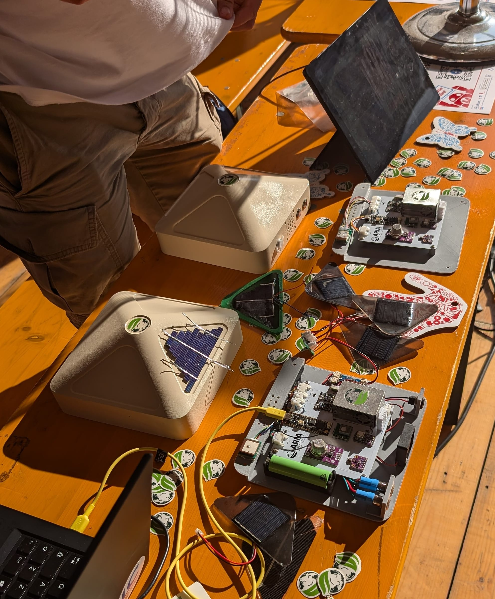
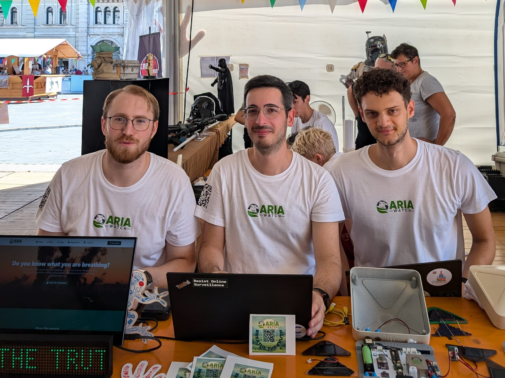

# Our First Time at Maker Faire Trieste 2024: An Incredible Experience

We are thrilled to share our experience at Maker Faire Trieste 2024, our very first time showcasing our project to the public. It was a truly amazing event for us, filled with enthusiasm, learning, and connection.

This was the first occasion where we unveiled our project on such a big stage, and the response was overwhelmingly positive. We received a lot of valuable feedback from visitors and fellow makers, which will undoubtedly help us improve and grow. The encouragement and interest we encountered gave us a boost of motivation and excitement for the future.

Moreover, Maker Faire Trieste allowed us to meet many talented and passionate makers from diverse backgrounds. It was inspiring to exchange ideas, learn about new innovations, and build a network of new colleagues and friends in the maker community.

Overall, this experience has been a significant milestone for our team, and we look forward to participating in more events like this. We are grateful for the opportunity and excited about what lies ahead.

Stay tuned to our blog for more updates on our journey and upcoming projects!
