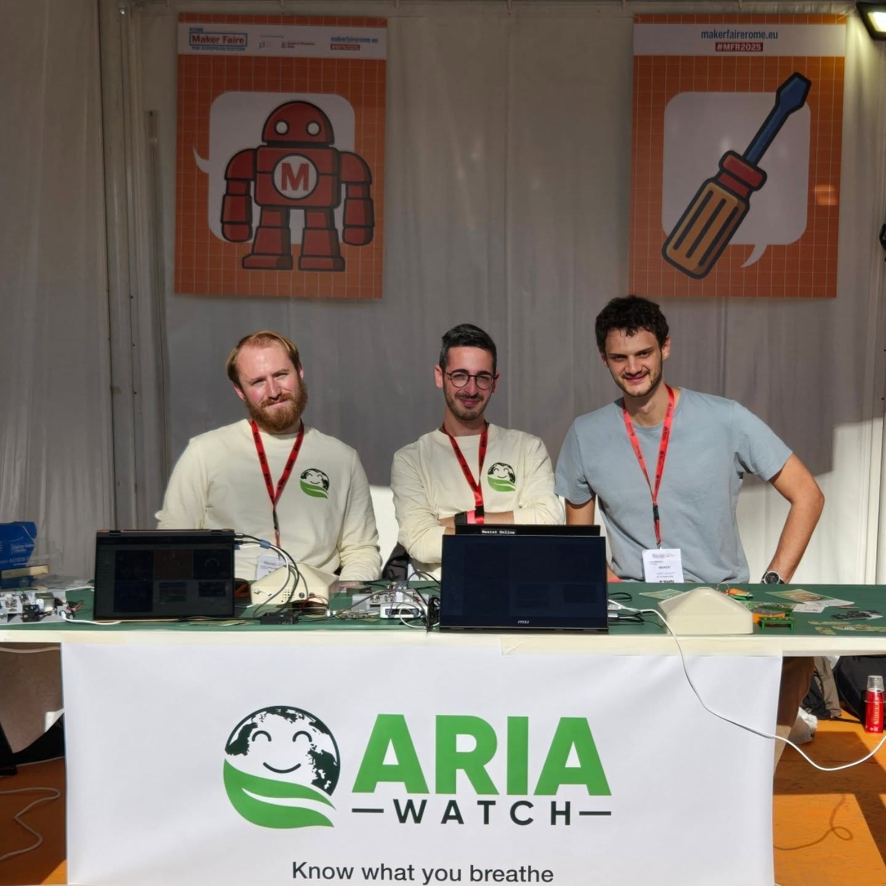
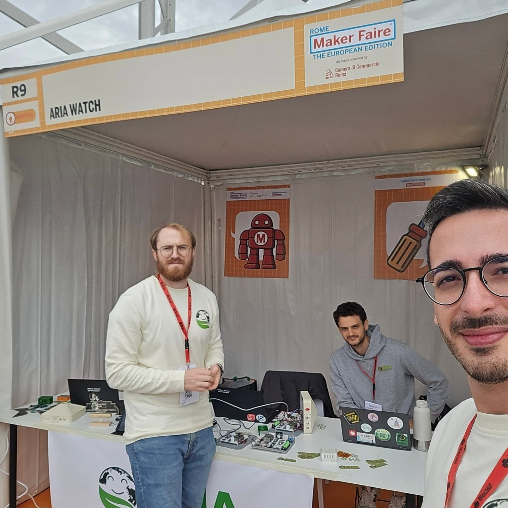
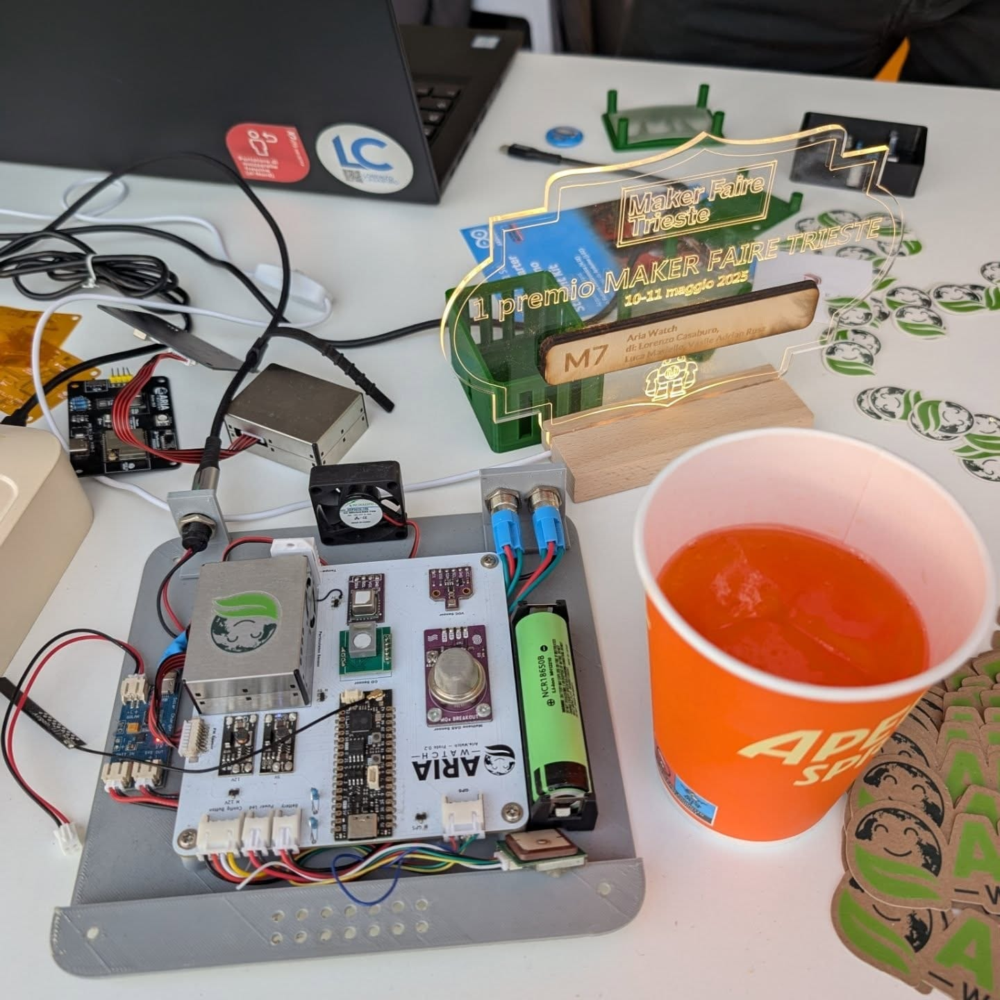

# Maker Faire Rome 2025

This year Aria Watch made it to **Maker Faire Rome – The European Edition**, the biggest maker event in Europe. After Trieste and Sovramonte, bringing our project to Rome was a dream come true, and it turned out to be one of the most beautiful experiences we've had so far.

## Our stand

You could find us at **stand R9**, with our boards, our prototypes and laptops running the Aria Watch dashboards. For three days we explained, again and again, what the sensors measure, why particulate matter and CO₂ matter for our health, and how anyone can build their own Aria Watch device from our open designs.

The first-prize trophy we won at [Maker Faire Trieste 2025](./2025-05-11-maker-faire-trieste-2025.md) came to Rome with us and stood proudly next to the prototype that won it.

## The best part: the people

What we'll remember most is the people. Meeting so many other makers — people who build robots, instruments, tools and crazy ideas in their garages and labs — was a huge emotion. Everyone was open, curious and happy to share what they'd learned, and we left with new friends, new ideas and a long list of things to try.

Just as precious were the visitors: families, students, teachers and people who simply wanted to know what's in the air they breathe every day. Their questions and feedback are exactly why we started Aria Watch.

## Thank you

A big thank you to the Maker Faire Rome organisers, to every maker we met and to everyone who stopped by our stand. We came home tired, happy and more motivated than ever to keep building.

See you at the next faire!
