# Borino PCB Assembly Guide

This guide describes the step-by-step process for assembling the Borino PCB, starting from receiving your custom board from the manufacturer.

If you wish to build the Borino device, it's important to have prior experience with soldering, particularly surface-mount (SMD) techniques. Alternatively, the device can be prototyped using a breadboard and pre-soldered modules, but this approach isn't covered in this guide.

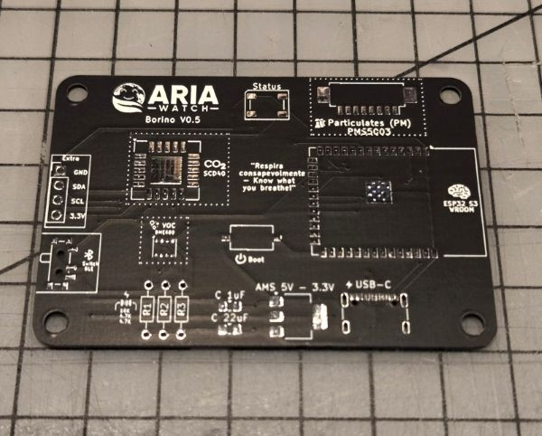

## Requirements

For the PCB build you are going to need at least the following.

### Tools

- Air solder (hot air station)
- Soldering iron
- Flux
- Solder paste
- Solder

### Components

- 1x [USB Type C 16 Pin](https://s.click.aliexpress.com/e/_c3QwlAOH) (USB4105)
- 1x [2.45mm 4 Pin Header](https://s.click.aliexpress.com/e/_c3BsQGPX)
- 1x [Molex 53261-0871 8 Pin](https://s.click.aliexpress.com/e/_c4enZrZJ)
- 1x [AMS1117 3.3v Regulator](https://s.click.aliexpress.com/e/_c3v3XeeV)
- 1x [5050 RGB WS2812B LED](https://s.click.aliexpress.com/e/_c4sTNSZF)
- 1x [ESP32-S3](https://s.click.aliexpress.com/e/_c3ZwtIFn) (with or without external antenna)
- 1x [1uF SMD 0805 Capacitor](https://s.click.aliexpress.com/e/_c2R7RMYp)
- 1x [22uF SMD 0805 Capacitor](https://s.click.aliexpress.com/e/_c2R7RMYp)
- 2x [4.7k Ohm 1/4W through hole resistors](https://s.click.aliexpress.com/e/_c4nYLeEN)
- 1x [10k Ohm 1/4W through hole resistor](https://s.click.aliexpress.com/e/_c4nYLeEN)
- 1x [PMS5003](https://s.click.aliexpress.com/e/_c4DNMPAv)
- 1x [Bosch BME680](https://s.click.aliexpress.com/e/_c3NJAwJn)
- 1x [SCD40](https://s.click.aliexpress.com/e/_c2RXf1OD)

All components can be sourced from popular suppliers such as AliExpress.

## Manufacturing the PCB

You can find the PCB design on our GitHub: [Aria-Watch/Aria-Watch-Borino-PCB](https://github.com/Aria-Watch/Aria-Watch-Borino-PCB).

Feel free to choose whichever manufacturer you prefer — we suggest JLCPCB.

## Let's assemble!

So, let's get to the assembly process.

First of all, start with the bare minimum to test the ESP and power-data connections.
We suggest following the process as described here, but in the end you need to assemble all the components, so feel free to do what you are comfortable with.

You can easily find where each component goes, as it's marked on the PCB.

### 1. Type C

Place the necessary solder paste and proceed by soldering the Type-C connector using hot air:

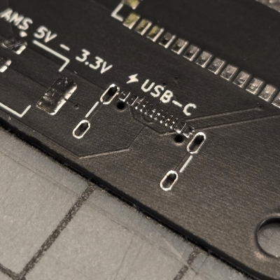

### 2. AMS1117 3.3V and capacitors

Proceed in order to solder the capacitors and the AMS power regulator. For these you can use a soldering iron, as the capacitors and the pads are big enough:

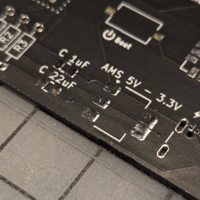

### 3. ESP32-S3

Last for now, solder the ESP32-S3 package.
_If you are brave enough_ you can solder each pin with the soldering iron, but it's recommended to do it with the hot-air station:

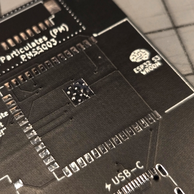

> [!NOTE]
> At this point all the basic components are soldered, so you can test that the USB power and data lines work correctly:
>
> - Connect the USB Type-C to a computer.
> - Verify that a new COM device shows up in the device manager.
> - If you see the device connecting/disconnecting, it's all right: the MicroPython firmware is still missing, so this is expected.

### 4. Resistors

You can now proceed to solder the rest of the components. The resistors are labeled on the PCB; for these we recommend using the soldering iron:

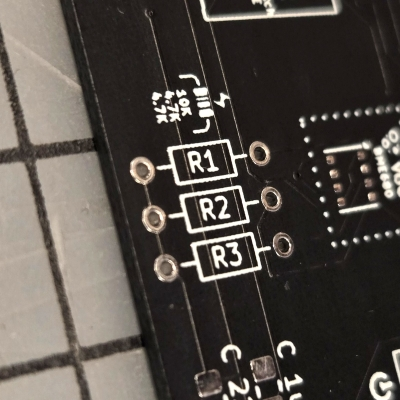

### 5. BLE Switch

As for the resistors, you can solder this tiny switch with the soldering iron:

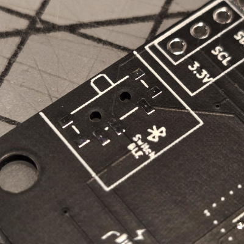

### 6. Headers

In the same area you will find the place for the I2C headers. Solder those if you want to expand the board with other custom sensors.

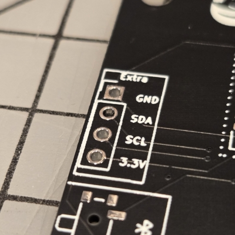

### 7. BOOT button

With the soldering iron, also solder the button used to choose the boot mode of the ESP32:

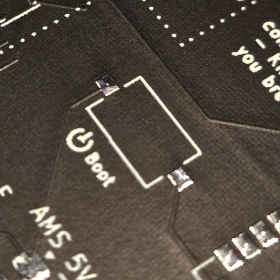

### 8. PM Sensor header (Molex 53261-0871 8 Pin)

Place some solder paste where needed and solder the Molex connector for the PM sensor using hot air:

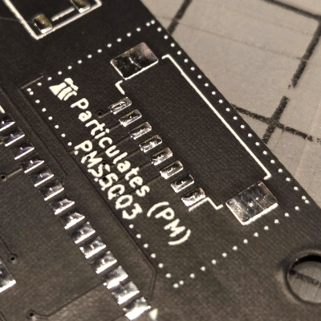

### 9. 5050 LED

Keeping the hot air in hand, place some solder paste on the LED pads and solder it:

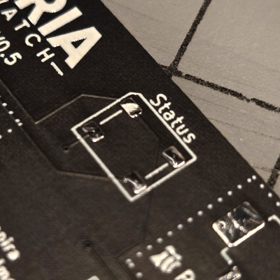

### 10. CO2 Sensor

Now for the section that needs the most attention: sensors!
Be careful while soldering these, as too much heat can damage them. Apply the _barely needed_ solder paste and start with the CO2 sensor:

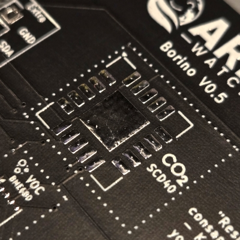

### 11. VOC Sensor

Last, the hardest one to solder with the heat gun: the Bosch VOC sensor. Apply just a bit of solder paste on the pads and put the little guy in place without losing it on the desk:

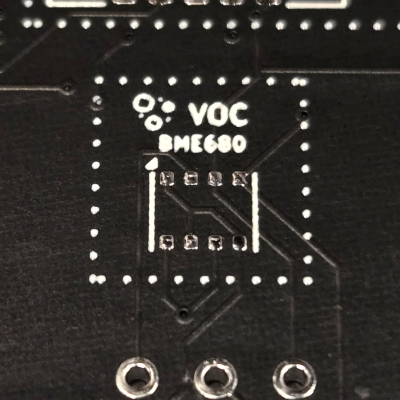

## Final steps: firmware installation

Refer to the [firmware README](https://github.com/Aria-Watch/Aria-Watch-Firmware) for connection and flashing instructions.

## Tips

- Follow component orientation and polarity as marked.
- Review each solder joint with a magnifier; cold or bridged joints commonly cause assembly issues.
- Ensure your work area is ESD-safe, especially when handling sensitive ICs.
- Include test and inspection steps after initial assembly for troubleshooting.
