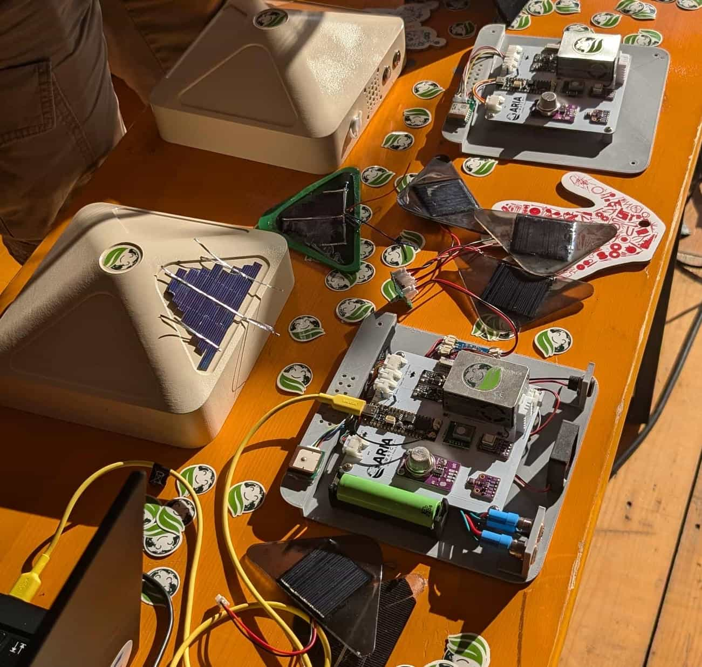
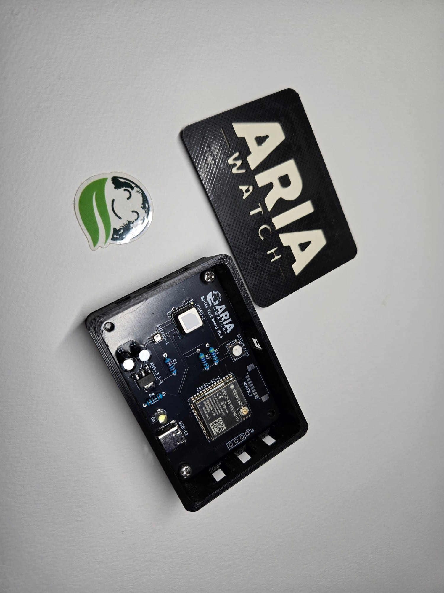
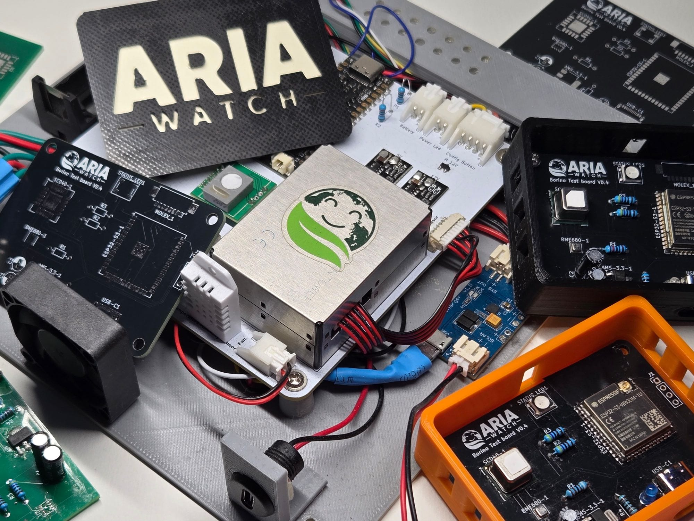

# About Aria Watch

Aria Watch is an open-source project born from a passion for environmental monitoring and a commitment to providing transparent, reliable air quality data. Our goal is to empower individuals and communities worldwide to understand their environment and take informed action against climate change.

## Our mission

We believe that accurate, accessible environmental data is essential in the fight against climate change. Aria Watch aims to combat misinformation by offering precise air quality measurements through innovative, open hardware devices combined with a collaborative global network.

## How it all started

Aria Watch began in **April 2023** as a short white paper titled _"Know what you breathe!"_. The starting point was simple: climate change is a global emergency, and it is surrounded by a wave of misinformation that makes it harder for citizens and decision-makers to act. Our answer was to give everyone **accurate, first-hand data** about the air, so that anyone can form an educated opinion — and compare the effect of new policies on the air quality of their own city.

That first draft already described the ideas we still build on today:

- **A device anyone can own** — a weather-resistant case with an angled front so rain slides off and the sun hits it, an air inlet protected by a removable mesh, a small fan to keep the air moving (stagnant air means false readings), a USB-C port and a battery you can swap without opening the case.
- **Many sensors in one box** — CO₂, methane, carbon monoxide, particulate matter (PM1, PM2.5, PM10), VOCs, temperature, humidity and pressure.
- **A network, not a gadget** — the more devices out there, the more precise the picture and the more places we can compare. Every device is calibrated the same way and sends its data to a shared server.
- **A community that reads the data** — a space where users and experts can explain what a change in the air actually means, and collaborations with environmental organisations to turn knowledge into action.

The first draft also imagined a token-based reward system on a blockchain to encourage people to install devices. **We have dropped that part completely.** Aria Watch is a small, open-source project: the reason to join is the data itself, the community, and the satisfaction of knowing what you breathe.

## The device

Our devices are equipped with advanced sensors to measure multiple environmental factors, including carbon dioxide, methane, carbon monoxide, particulate matter (PM1, PM2.5, PM10), volatile organic compounds (VOCs), temperature, humidity, and atmospheric pressure. They are designed to be weather-resistant and user-friendly, featuring solar panels, easily replaceable filters, and secure enclosures with USB-C connectivity.

All designs, schematics, firmware, and assembly instructions are open and freely available to anyone wishing to build, modify, or improve their own Aria Watch device.

## Our journey so far

- **April 2023** — the first white paper, _"Know what you breathe!"_.
- **May 2024** — our debut at [Maker Faire Trieste](../blog/2024-05-23-maker-faire-trieste-2024.md).
- **April 2025** — [Innovation Faire Sovramonte](../blog/2025-04-27-innovation-faire-sovramonte-2025.md).
- **May 2025** — back in Trieste, where we won the [first prize for the best project](../blog/2025-05-11-maker-faire-trieste-2025.md).
- **October 2025** — [Maker Faire Rome – The European Edition](../blog/2025-10-20-maker-faire-rome-2025.md).

## Community and experience

Aria Watch was proudly showcased at Maker Faire events, connecting with a vibrant maker community driven by curiosity and innovation. Our diverse and dedicated team brings together expertise in electronics, software, environmental science, and design, all fueled by a shared passion for making a positive environmental impact.

Beyond technology, Aria Watch fosters a collaborative community where users can share data, insights, and ideas to promote awareness and support climate action worldwide.

## Get involved

Whether you are a maker, researcher, activist, or simply interested in environmental transparency, you are welcome to join the Aria Watch community. Explore our documentation, contribute to the project, or reach out through our GitHub.

Together, we can build a healthier planet by turning data into action.

[Join us on GitHub](https://github.com/Aria-Watch/)

## Contact us

Have questions or want to get in touch? You can reach us through the following channels:

- **GitHub Issues and Discussions** — technical support, feature requests, and community interaction: [Aria-Watch/Aria-Watch-Borino-PCB](https://github.com/Aria-Watch/Aria-Watch-Borino-PCB)
- **Email** — [info@aria.watch](mailto:info@aria.watch)
- **Instagram** — updates and news: [@aria.watch_official](https://www.instagram.com/aria.watch_official/)

We look forward to hearing from you!
